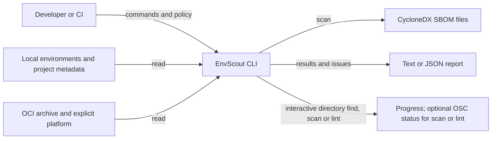
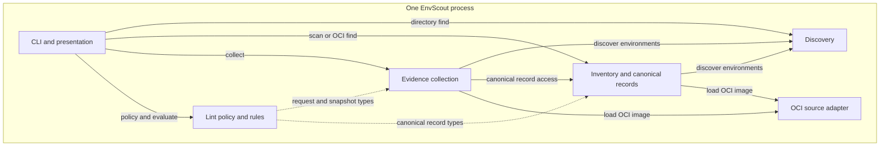
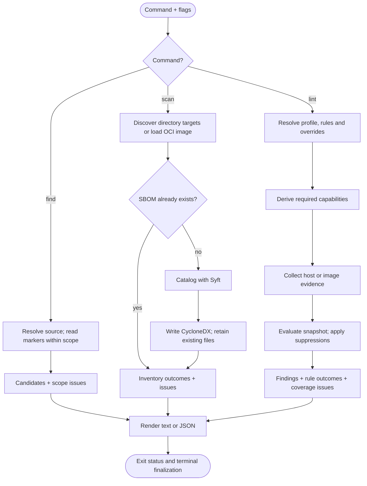

# Architecture

## System inputs and outputs

Arrows show information flow, not dependencies or execution order.

Environments, project locks and image layers provide distinct evidence. Inventory is not a vulnerability verdict or proof of deployment. Existing SBOMs are retained; OCI staging files are cleaned up.

## Package dependencies

Boxes show Go packages or groups in one process with linked libraries, not services. Arrows show calls (solid) or shared-type dependencies (dashed), not every import. The CLI passes rule-derived requests to collectors and snapshots to rules; rules never invoke collectors.

| Package / group | Code | Responsibility and libraries |
| --- | --- | --- |
| Entry point / CLI | [`cmd/envscout`](../cmd/envscout), [`internal/cli`](../internal/cli) | Signals, flags, timeout, orchestration, rendering and exit codes; Cobra. Text/OSC progress stays here, separate from reports. |
| Discovery | [`internal/discovery`](../internal/discovery) | Bounded known-location hints or explicit-root traversal; conda/venv markers, exclusions and scope issues. fastwalk for host traversal. |
| OCI adapter | [`internal/imageinput`](../internal/imageinput) | Load one archive/platform, expose identity, final filesystem and layers, and own staging cleanup; stereoscope. |
| Inventory | [`internal/inventory`](../internal/inventory) | Offline Syft cataloging and CycloneDX output; pure canonical conda document parsing shared by evidence, with resolver-based record access retained for images. |
| Evidence | [`internal/evidence`](../internal/evidence) | Collect requested records, ownership, Python metadata, caches, project/lock facts or layer artifacts; return snapshots with coverage and issues. |
| Lint | [`internal/lint`](../internal/lint) | Normalize profiles/config, derive requirements, evaluate without filesystem I/O, apply suppressions and report findings/outcomes. |

`go-rattler` supplies conda records, versions/specs and Pixi lock semantics through CGO and Rust rattler; builds need Go, Rust/Cargo and a C compiler. Syft catalogs packages; EnvScout owns source selection, evidence boundaries and policy orchestration.

## Command workflow

The flowchart omits detailed failure and cancellation branches. Arrows show possible next steps, diamonds select alternatives, and converging paths are not parallel work.

- `find`: no roots means bounded hints; roots mean recursive discovery. Markers identify candidates, not working interpreters or valid package records.
- `scan`: one SBOM per discovered directory environment, or one whole-image SBOM for an OCI archive's final filesystem. Cataloging is offline.
- `lint`: no prerequisite SBOM. Host collection discovers targets, validates canonical records, prepares coverage, optionally associates projects, then inspects evidence. Images can also yield historical-layer evidence of retained content.

[`ParseCondaRecord`](../internal/inventory/records.go) parses original document bytes and preserves ownership omission versus an explicitly empty list. Readers own file admission, bounds and source attribution: host records use confined reads directly, final image records retain the Syft resolver path, and historical installed records retain their layer-reference reads and limits. Historical cache index markers still use their separate index parser. The host Python metadata resolver remains separate.

Offline SBOM tests use the same conda-enabled catalog path as the writer; project tests use the context-aware collector directly. Fixture helpers share file-creation mechanics only where paths, bytes and modes are identical. Sparse SBOM records, canonical installed records, cache index markers and ownership omission/empty cases remain distinct inputs, not one universal fixture schema.

The pure [ownership index](../internal/inventory/ownership.go) records caller-admitted path claims and sticky ambiguity; the host collector still localizes paths, checks its metadata index and reports ownership gaps. The [history parser](../internal/discovery/history.go) counts transaction headers from a reader, while discovery retains cancellation, total-byte bounds and confined file access.

[Host Python metadata classification](../internal/evidence/host_python.go) shares the container-to-primary filename decision, not one admission policy. Exact primary-file presence, lowercase identity-gap checks, virtualenv-only missing-primary issues and direct supporting-file cataloging remain distinct.

Image collection borrows a fully loaded image whose trees, nodes, references, catalog and backing content stay stable until collection finishes; loading, mutation and cleanup cannot overlap collection. A collector-local [marker-validity memo](../internal/evidence/image.go) retains at most 10,000 reference-ID-to-boolean outcomes from completed bounded index-marker reads, including invalid parses but not read errors or raw bytes. At capacity it reads new references without retaining them. Each consumer still owns admission, limits and diagnostics; historical marker timing remains layer-specific. The [content-identity guard](../internal/evidence/image_links.go) remains separate: marker validity does not prove an adopted hardlink's original shared inode identity.

Final basename-following link lookups reuse only a scalar reference result, including successful reference-less directories. The lazy collector-local memo retains at most 10,000 exact request keys and 1 MiB of cloned key/real-path string bytes, plus bounded map/reference overhead, not a 1 MiB RSS ceiling. Direct nonlink results, failures and canceled lookups are not retained; saturation silently bypasses new entries. Hits preserve the lookup's context checkpoints, while consumers repeat metadata, executable and content-identity checks. No resolution chains, raw bytes, historical lookups or default-mode overwrite results enter this memo.

Image-local path resolution and cache relevance share bounded component/link rewriting, not one proof policy. Resolution requires existing components and nonempty link destinations; relevance checks cache roots before node existence and remains conservative on cancellation. Final-cache, cache-link and historical-retention collectors keep separate traversals, budgets and diagnostic timing; historical roots still come from their as-of-layer contexts.

## Lint rule extension

Rules are compiled-in Go checks, not runtime plugins. The [registry](../internal/lint/registry.go) defines stable IDs/versions, descriptions, sources, capabilities, profile defaults, recommendations and exceptions. Configuration adjusts registered rules; `--list-rules` uses this registry.

[`BuildPolicy`, `Requirements` and `Evaluate`](../internal/lint/engine.go) resolve policy, derive collection requests and evaluate snapshots. A private [execution view](../internal/lint/execution.go) combines normalized options with support derived from the registry once per operation. Policy validation, requests, preparation and applicability use that support; public policy serialization and digests are unchanged. [Named capability constants](../internal/evidence/model.go) connect requests, collector coverage and rules without changing their string values. The clock and cross-target peers belong to [lint-owned evaluation context](../internal/lint/evaluation.go), not collected evidence.

Collectors own I/O; `Check` reads a target and effective options, returning an outcome and findings without mutation or fixes. Context-aware preparation supplies the clock or peer scope and prepares immutable shared facts once per evaluation. The engine applies suppressions and report limits. Checks must respect coverage: partial evidence can establish findings, not absence. `unknown`, `unavailable` and `not_applicable` are not `pass`.

[Shared channel facts](../internal/lint/channel.go) expose canonical identity and recognized family without imposing one package-validity definition. Mixed-channel checks recognize defaults main/r/msys2 and conda-forge; CA recommendations support defaults main and conda-forge only. Duplicate-set checks retain their stricter identity requirements. Conda and Python version semantics remain separate.

To add or improve a rule:

1. Define the observation and limits; reuse facts and named capabilities. Add bounded collectors with coverage and issue reporting for new evidence; rule support metadata does not replace collector dependency checks.
2. Implement the check in `internal/lint`; register metadata, capabilities, source/virtualenv support and profile defaults. Reuse finding helpers; use context-aware preparation when a check needs the evaluation clock, peer scope or shared facts.
3. Test findings, clean/incomplete evidence, applicability, policy overrides, deterministic identity and snapshot immutability. Test collector/CLI contracts when changed.
4. Bump rule/ruleset versions for predicate changes and profile/report/config versions for contract changes. Keep rule-specific branches out of the engine and CLI.

## Boundaries

- `cmd/` owns startup; `internal/` keeps implementation APIs private. CLI owns output and terminal behavior; domain packages return results and counters.
- Callers supply `context.Context`; source owners close sources/images and clean staging. Read/result limits are not hard process memory/time quotas.
- OCI archives must be trusted; archive processing runs in-process and is not sandboxed.
- Evidence carries coverage. Read failures, limits and cancellation retain positives and report gaps, not a clean result.
- Host/image access, links, caches and layers have distinct semantics. Exclusions affect discovery, not selected package contents or whole-image cataloging.
- Text/JSON reports, including inspection issues, use stdout; operational warnings, debug output and progress use stderr. OSC percentages require known directory scan/lint totals, never discovery.

Update responsibilities and workflows, not struct lists. Keep proposed integrations separate; record significant boundary decisions in short ADRs. See the [CLI guide](../README.md) for commands and limits, and [Go's module layout guidance](https://go.dev/doc/modules/layout) for `cmd/` and `internal/`.
