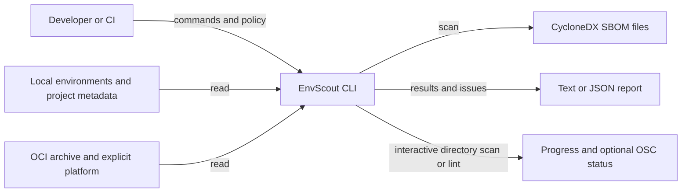
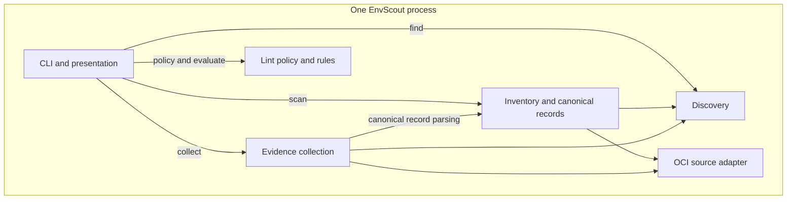
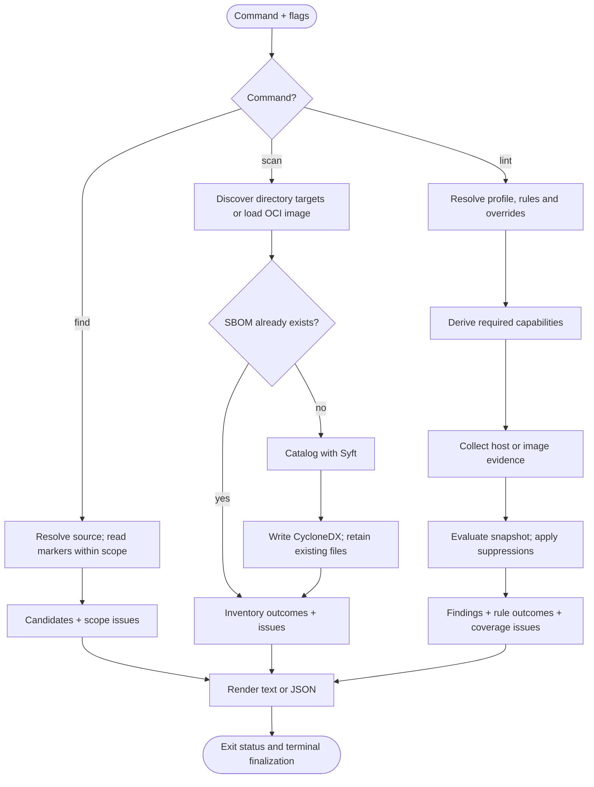

# Architecture

EnvScout is an experimental, offline CLI for discovering environments, producing package inventories and explaining policy findings. It reads files and metadata without running Python, package managers or containers. This describes the implemented product, not the RFC's proposed upload, vulnerability matching or environment-management services.

Use a lightweight [C4](https://c4model.com/diagrams) view: system context, package-level components and an activity flow. EnvScout is one process, not a collection of services. Plain Mermaid flowcharts keep these views portable; code-level diagrams would add detail without explaining the workflow.

## System context

Installed environments, project locks and image layers are different evidence sources. An inventory is neither a vulnerability verdict nor proof of what is deployed. Existing SBOM files are retained rather than overwritten; OCI inspection also creates temporary staging files that are cleaned up.

## Components

Arrows show major package usage, not every import. Dependencies are linked libraries, not separate services.

| Component | Code | Responsibility and libraries |
| --- | --- | --- |
| Entry point / CLI | [`cmd/envscout`](../cmd/envscout), [`internal/cli`](../internal/cli) | Signals, flags, timeout, orchestration, rendering and exit codes; Cobra. Text/OSC progress stays here, separate from reports. |
| Discovery | [`internal/discovery`](../internal/discovery) | Bounded known-location hints or explicit-root traversal; conda/venv markers, exclusions and scope issues. fastwalk for host traversal. |
| OCI adapter | [`internal/imageinput`](../internal/imageinput) | Load one archive/platform, expose identity, final filesystem and layers, and own staging cleanup; stereoscope. |
| Inventory | [`internal/inventory`](../internal/inventory) | Offline Syft cataloging and CycloneDX output; canonical conda record access/parsing reused by evidence. |
| Evidence | [`internal/evidence`](../internal/evidence) | Collect only requested capabilities: records, ownership, Python metadata, caches, project/lock facts or image-layer artifacts. Return a snapshot with coverage and issues. |
| Lint | [`internal/lint`](../internal/lint) | Normalize profiles/configuration, derive evidence requirements, evaluate rules without filesystem I/O, apply suppressions and produce findings/outcomes. |

`go-rattler` provides conda records, versions/specs and Pixi lock semantics through CGO into Rust rattler. The build therefore needs Go, Rust/Cargo and a C compiler. Syft owns broad package cataloging; EnvScout owns source selection, evidence boundaries and policy orchestration.

## Command activity

- `find`: no roots means bounded hints; roots mean recursive discovery. Markers identify candidates, not working interpreters or valid package records.
- `scan`: one SBOM per discovered directory environment, or one whole-image SBOM for an OCI archive's final filesystem. Cataloging is offline.
- `lint`: no prerequisite SBOM. Host collection stages are discovery, canonical validation, coverage preparation, optional project association and evidence inspection. Image collection can also inspect historical layers for retained content.
- Lint evaluation consumes a snapshot, effective policy and time. Rules select evidence requirements; findings explain observations rather than apply fixes.

## Boundaries

- `cmd/` owns process startup; `internal/` packages keep implementation APIs private. CLI packages own output and terminal behavior; domain packages expose results and counters.
- Callers supply `context.Context`; source owners close sources/images and release staging. Bounds on reads and result counts are not a hard process memory/time quota.
- Coverage travels with evidence. Read failures, limits and cancellation retain observed positives and report gaps rather than silently treating missing evidence as clean.
- Host and image paths keep separate access, link, cache and layer semantics. Discovery exclusions narrow discovery, not selected package contents or whole-image cataloging.
- Text/JSON reports are stdout; diagnostics/progress are stderr. OSC percentages start only once directory scan/lint has a known total, not during discovery.

For changes, update package responsibilities and workflows rather than listing structs. Keep proposed integrations separate, and record significant boundary decisions in short ADRs. See the [CLI guide](../README.md) for supported commands and limits, and [Go's module layout guidance](https://go.dev/doc/modules/layout) for the `cmd/` / `internal/` convention.
